  

# 🏢 Awesome Enterprise Scalability & Compliance 🚀

**Curated Index of Enterprise Test Orchestration, Governance Controls, and Cloud Quality Platforms**  
*Comprehensive landscape of enterprise QA platforms, Kubernetes test execution grids, SSO/RBAC compliance solutions, and open-source test architectures.*

---

## 📑 Table of Contents
- [🔍 Sector Overview & Market Dynamics](#-sector-overview--market-dynamics)
- [☁️ SaaS / Hosted Enterprise Platforms](#️-saashosted-enterprise-platforms)
- [💻 Open-Source GitHub Projects](#-open-source-github-projects)
- [📈 Star History](#-star-history)
- [🤝 How to Contribute](#-how-to-contribute)
- [💖 Support](#-support)
- [⚖️ Disclaimer](#️-disclaimer)

---

## 🔍 Sector Overview & Market Dynamics

The global enterprise automated testing and continuous quality market is currently estimated between **$32B and $40B** (projected to surge past **$75B+ by the early 2030s** at a ~15% CAGR), with dedicated continuous testing and CI/CD quality engineering tools accounting for roughly **$2.5B to $3.5B**. 

The sector is **moderately fragmented**: while tier-1 leaders (Keysight, OpenText, Tricentis, BrowserStack, SmartBear) command roughly 30%–40% combined market revenue, no vendor commands a winner-take-all monopoly. Enterprise software delivery pipelines remain diverse—bridging heterogeneous frameworks (Selenium, Playwright, Cypress, Appium), mission-critical ERP suites (SAP, Salesforce, Oracle), hybrid Kubernetes orchestration grids, and strict regional regulatory mandates (SOC 2, ISO 27001, HIPAA, GDPR, FedRAMP).

---

## ☁️ SaaS / Hosted Enterprise Platforms

Enterprise-ready testing clouds with advanced identity management (SSO/SAML, SCIM), role-based access control (RBAC), immutable audit logging, dedicated device clouds, and global execution parallelism.

| Product | 🏢 Company Size (Valuation / Revenue) | 💰 Starting Price | 🎁 Free Tier / Trial Limits | 📋 Description & Enterprise Highlights |
|---|---|---|---|---|
| **[Keysight Eggplant](https://www.keysight.com/)** | ~$49.5B Market Cap (NYSE: KEYS) / ~$5.4B Revenue | $9,999 (3-month Quick Start evaluation package; enterprise annual tiers ~$50,000+/year) | 14-day free trial (evaluation license with access to Eggplant Test DAI environment) | **AI-driven test automation** using computer vision and machine learning. Tests applications the way a user sees them—no scripting required. |
| **[Micro Focus (OpenText) Silk Test](https://www.opentext.com/)** | ~$6.0B Market Cap (NASDAQ: OTEX) / ~$5.19B Revenue | $1,500/seat/year (Named user entry subscription via authorized enterprise licensing) | 30-day proof-of-concept / evaluation license upon sales request (no open self-serve tier) | Enterprise functional testing for web, mobile, and desktop. Positioned for large organizations with legacy investments in the Micro Focus/OpenText ecosystem. |
| **[Tricentis Tosca](https://www.tricentis.com/)** | $4.5B Valuation / ~$500M ARR | $14,600/year (SMB base contract; NeoLoad from ~$20,000/yr, Tosca enterprise deployments ~$50,000+/yr) | 14-day free trial (cloud-based evaluation including Agentic Test Automation features) | **Agentic AI embedded in Tosca** turns plain-language prompts into complete test cases across SAP, Salesforce, and web—cutting test creation time by **up to 85%** . **Elastic Execution Grid** enables highly scalable parallel test execution in the cloud. Covers **200+ technologies** including SAP, Salesforce, APIs, and desktop . |
| **[BrowserStack Enterprise](https://www.browserstack.com/)** | $4.0B Valuation / ~$230M ARR | $29/month (billed annually for Live; Automate starts at $59–$99/parallel/month) | 30 minutes of Live interactive testing (1 min/device limit) & 100 automated testing minutes | **Enterprise add-on available on all plans** unlocking SSO, priority support, dedicated Customer Success Manager, dedicated Solutions Engineer, advanced access control (upcoming), and audit log (upcoming) . **Company-wide plans** offer up to **90% less per user** versus individual licenses—add users without license management . |
| **[SmartBear Enterprise](https://smartbear.com/)** | $2.0B Valuation / ~$150M+ ARR | $2,200/year (Node-locked TestComplete Base; floating licenses start from ~$5,000/year) | 14-day free trial (unrestricted full-feature evaluation of TestComplete, no credit card required) | Enterprise offerings across TestComplete, ReadyAPI, and BitBar. Positioned for organizations needing consolidated vendor relationships across UI, API, and device testing. |
| **[Sauce Labs Enterprise](https://saucelabs.com/)** | ~$600M Valuation / ~$100M+ Revenue | $39/month (billed annually for Live; Real Device Cloud starts from $199/parallel/month) | 28-day free trial (capped at 60 minutes automated/live testing & 3 parallel VMs) | **Enterprise Level** includes SSO, private device cloud, Sauce IPSec Proxy, team management, premium support options, technical workshops, professional services, and enterprise-grade security . **Access API** (Enterprise plans only) enables custom device automation via HTTP/WebSockets without framework dependency . |
| **[TestMu AI (LambdaTest) Enterprise](https://www.lambdatest.com/)** | $400M Valuation / ~$25M+ Revenue | $15/month (billed annually for Live; Web/App automation starts at $79–$99/parallel/month) | Lifetime Free Tier: 60 live testing mins (10 mins/session), 100 automation mins, 10 responsive tests/mo | **Sub-organizations** feature (Enterprise plan only) lets you segregate test data across business units, distribute concurrency, and manage users independently . **HyperExecute Enterprise** adds SSO, dedicated chat support, on-prem/dedicated cloud setups, custom retention, usage analytics, and custom vault integration . |
| **[Cypress Enterprise](https://www.cypress.io/)** | $255M Valuation / ~$15M–$20M ARR | $67/month (Cypress Cloud Team plan; Business tier starts at $267/month) | Free Forever Plan: 500 test results/month, up to 50 user seats, and 30 days data retention | Enterprise plan for Cypress Cloud with SSO, parallelization, flake detection, and analytics. The CLI itself remains open-source (MIT). |
| **[Katalon Enterprise](https://katalon.com/)** | ~$100M Valuation ($28.7M raised) / ~$15M+ ARR | $150/month (billed annually as Studio Enterprise; Cloud Platform bundles from $1,699/year) | Free Forever Plan: Katalon Studio local IDE authoring/execution (no CI/CD CLI execution) & 30-day platform trial | **SSO/SAML and SCIM provisioning, RBAC, audit logs, private cloud or on-premises deployment, centralized license management, and custom SLA** . Includes **AI agents for test automation**, MCP server for AI stack integration, and **hybrid licensing** for air-gapped environments . |
| **[Worksoft Certify](https://www.worksoft.com/)** | ~$75M Valuation ($42M raised) / ~$38M Revenue | $1,500/user/year (Core entry subscription for SAP/ERP test execution; full suites ~$6,000/node/yr) | 30-day sales-assisted evaluation / proof-of-concept trial license | **Enterprise test automation for SAP and complex business processes**. Positioned for large-scale ERP testing with codeless automation. |

---

## 💻 Open-Source GitHub Projects

Curated open-source testing tools, distributed execution engines, Kubernetes-native orchestrators, and enterprise-scale architectural blueprints. **Sorted in descending order by GitHub_Stars.**

| 🌟 Open-Source Repository | 🏷️ Stars_Badge | 📜 License | 📝 Overview & Architectural Role |
|---|---|---|---|
| **[Playwright](https://github.com/microsoft/playwright)** |  | Apache-2.0 | **Cross-browser automation framework for modern web applications.** Provides native auto-waiting, resilient web assertions, tracing, multi-context browser isolation, and parallel execution for enterprise CI/CD systems. |
| **[Cypress](https://github.com/cypress-io/cypress)** |  | MIT | **Fast, easy, and reliable testing for anything that runs in a browser.** Complete developer-first end-to-end and component testing engine with time-travel debugging, network stubbing, and automatic reloading. |
| **[Selenium](https://github.com/SeleniumHQ/selenium)** |  | Apache-2.0 | **The foundational W3C-standard browser automation framework.** Powers distributed browser grids (Selenium Grid 4), scalable parallel infrastructure, and multi-language enterprise quality platforms across Chrome, Firefox, Edge, and Safari. |
| **[k6](https://github.com/grafana/k6)** |  | AGPL-3.0 | **Modern developer-centric load and performance testing tool in Go and JavaScript.** Designed for high-concurrency enterprise stress testing, Kubernetes integration, and automated CI/CD performance regression gates. |
| **[Locust](https://github.com/locustio/locust)** |  | MIT | **Scalable, developer-friendly load testing tool scriptable in pure Python.** Enables distributed worker swarms capable of simulating millions of concurrent users against enterprise endpoints with real-time web dashboards. |
| **[Appium](https://github.com/appium/appium)** |  | Apache-2.0 | **Cross-platform mobile test automation framework.** Supports iOS (XCUITest), Android (UiAutomator2/Espresso), Windows, and macOS apps under a unified WebDriver protocol without requiring SDK recompilation. |
| **[Gatling](https://github.com/gatling/gatling)** |  | Apache-2.0 | **High-performance load testing engine as code.** Employs an asynchronous, non-blocking actor architecture on the JVM (Java, Scala, Kotlin, TypeScript) capable of massive enterprise request throughput with minimal resource footprint. |
| **[Allure Report](https://github.com/allure-framework/allure2)** |  | Apache-2.0 | **Lightweight, multi-language enterprise test reporting tool.** Transforms test results from JUnit, TestNG, Playwright, PyTest, and Cucumber into clear graphical dashboards with step trees, execution timelines, and failure attachments. |
| **[Testkube](https://github.com/kubeshop/testkube)** |  | MIT / Commercial | **Kubernetes-native test orchestration engine.** Runs test suites natively inside Kubernetes clusters as CRDs, decoupling test runs from CI runners with an open-source agent and a commercial control plane for enterprise SSO, RBAC, and multi-cluster auditing. |
| **[QA Multipurpose Framework](https://github.com/VladimirRamirez07/qa-multipurpose-framework)** |  | MIT | **Reference architecture for enterprise test automation across Web, API, and Mobile.** Implemented with TypeScript, Playwright, Appium, Allure, and BrowserStack cloud execution following SOLID principles and Page Object Model (POM). |
| **[SDET Enterprise Automation Framework](https://github.com/chukwuma1976/sdet-enterprise-automation-framework)** |  | MIT | **Enterprise SDET blueprint in modern Java 25.** Combines JUnit 5, Playwright, Selenium, RestAssured, and k6 performance testing with modular CI pipeline integration and custom exception handlers. |

---

## 📈 Star History

---

## 🤝 How to Contribute

We welcome community contributions, architectural patterns, and updates to enterprise listings!

1. 🍴 Fork the repository.
2. 🌿 Create a feature branch (`git checkout -b feature/awesome-platform`).
3. 📝 Add or update entries in `README.md` keeping descriptions factual, concise, and linked to official documentation.
4. 🚀 Open a Pull Request with a clear description of the addition or correction.

⭐ **If you find this ecosystem index helpful, please star the repository!**

---

## 💖 Support

Thank you for exploring this curated repository! If you find this collection helpful for evaluating enterprise scalability, compliance tooling, and quality infrastructure:

- ⭐ **Star** this repository on GitHub.
- 🍴 **Fork** and contribute additions or updates.
- 📢 **Share** it with fellow QA leaders, SDETs, and DevOps engineers.
- ☕ **Buy me a coffee / Sponsor**: If you'd like to support continued maintenance and curation of open-source resources, visit the [GitHub Sponsor Dashboard](https://github.com/sponsors/ishandutta2007).

---

## ⚖️ Disclaimer

- This is a **community-curated index** — not an exhaustive registry nor an official endorsement.
- Enterprise testing platforms handle source code, proprietary application logic, test data, and potentially production-like credentials; always verify compliance (SSO/SAML, SCIM, RBAC, encryption at rest/in transit, and audit logging) with your organization's security posture and legal regulations.
- Pricing, packaging, and commercial terms are subject to change by respective vendors. Validate current tiers directly with each vendor prior to procurement.

---

  <b>Built for QA leaders, platform engineers, and engineering organizations building compliant, scalable test infrastructure.</b>

